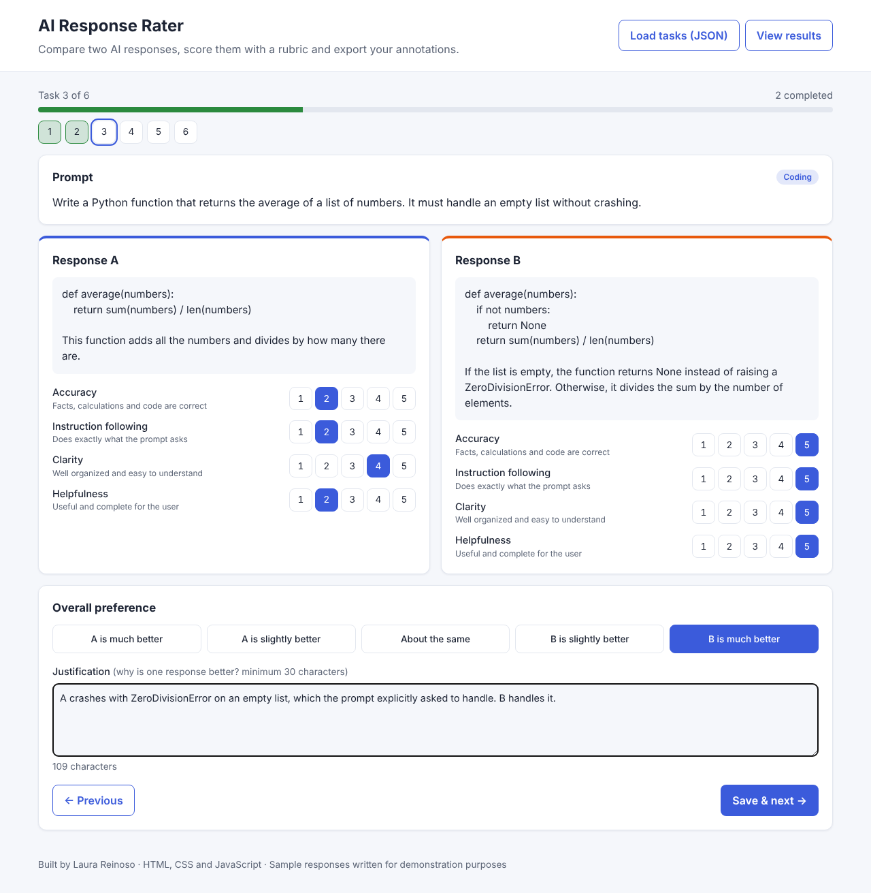
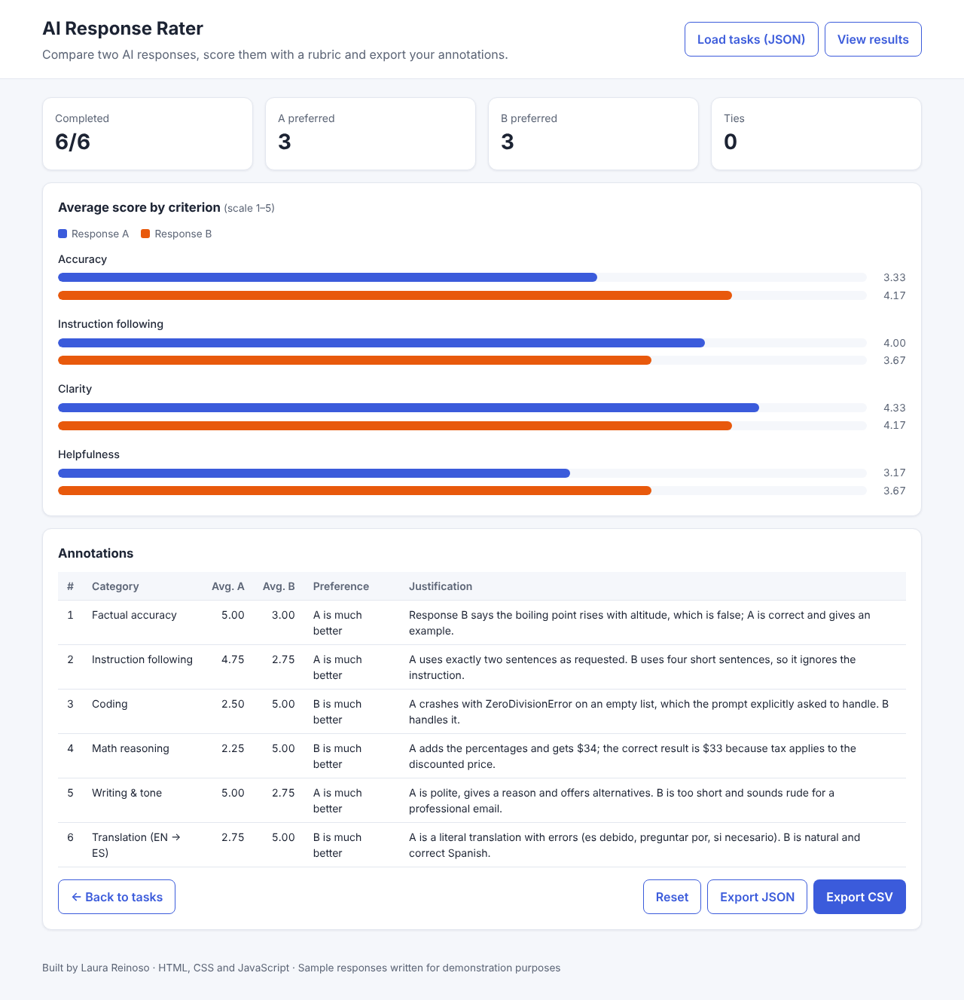

# AI Response Rater

A web tool for side-by-side evaluation of AI responses, inspired by the workflows used to create training data for language models (RLHF / preference data). The annotator reads a prompt, scores two responses with a rubric, chooses which one is better, writes a justification and exports the results.

**Live demo:** https://lauravanessa-r.github.io/ai-response-rater/



## Features

- **Side-by-side comparison** of two responses to the same prompt.
- **Rubric scoring (1–5)** for each response on four criteria: accuracy, instruction following, clarity and helpfulness.
- **Overall preference** on a 5-point scale, from "A is much better" to "B is much better".
- **Required justification** with a minimum length, as in real annotation guidelines.
- **Quality checks** before saving: every criterion must be scored, and the preferred response cannot have a lower average score than the other one.
- **Progress tracking** with a progress bar and quick navigation between tasks. Progress is saved in the browser, so it is not lost when the page is reloaded.
- **Results summary:** number of tasks won by each response, ties, and average score per criterion.
- **Export** the annotations to CSV (opens correctly in Excel) or JSON.
- **Load your own tasks** from a JSON file.
- No external libraries, responsive layout and automatic light/dark mode.



## Built with

- HTML5, CSS3 and vanilla JavaScript (ES6+)
- `localStorage` to save progress
- No frameworks or dependencies

## Project structure

```
ai-response-rater/
├── index.html               # Page layout (annotation and results views)
├── style.css                # Styles, light/dark theme and responsive design
├── js/
│   ├── tasks.js             # Sample evaluation tasks
│   └── app.js               # Rubric, validation, navigation, results and export
├── data/
│   └── tasks-example.json   # Example of the format for loading custom tasks
└── assets/
    ├── screenshot-task.png
    └── screenshot-results.png
```

## Sample tasks

The six included tasks cover different skills an AI evaluator checks: factual accuracy, instruction following, coding, math reasoning, writing tone and English-to-Spanish translation. The responses were **written for this demo**, and one response in each pair contains a deliberate problem (a factual error, an ignored instruction, a bug, a wrong calculation, an inappropriate tone or an unnatural translation). The better response appears as A in some tasks and as B in others, to avoid position bias.

## Load your own tasks

Click **Load tasks (JSON)** and select a file with this format (see `data/tasks-example.json`):

```json
[
  {
    "id": "task-01",
    "category": "Factual accuracy",
    "prompt": "The question or instruction given to the model",
    "responseA": "First response",
    "responseB": "Second response"
  }
]
```

`id`, `prompt`, `responseA` and `responseB` are required, and every `id` must be unique. `category` is optional.

## Exported data

The CSV includes one row per completed task with the scores of each criterion for both responses, the average of each response, the preference, the winner (`A`, `B` or `tie`), the justification and the date it was saved.

## Run it locally

Download or clone the repository and open `index.html` in your browser. No server or installation is needed.

```bash
git clone https://github.com/lauravanessa-r/ai-response-rater.git
```

## Possible improvements

- Randomize the order of the responses to reduce position bias
- Time spent per task
- Agreement metrics between several annotators (for example, Cohen's kappa)
- Keyboard shortcuts for faster scoring

## Author

**Laura Reinoso** — Statistician · Data Annotator · Front-end Developer
[LinkedIn](https://www.linkedin.com/in/laura-reinoso-a04321371) · [GitHub](https://github.com/lauravanessa-r)

## License

This project is licensed under the [MIT License](LICENSE).
